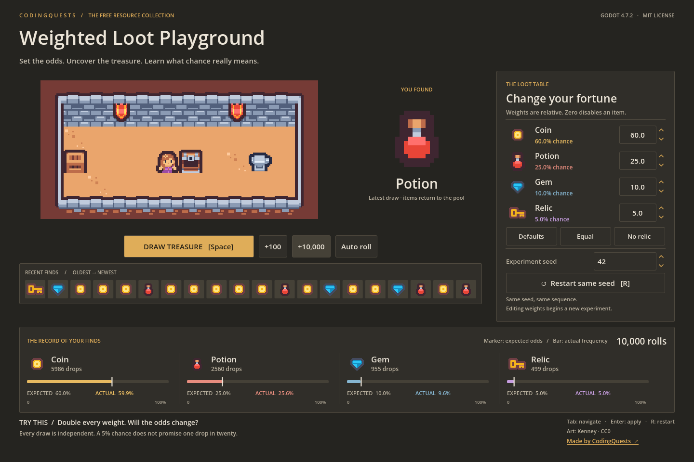

# Weighted Loot Playground

Tune a loot table and understand what its odds mean. Change four weights, roll once or 10,000 times, and compare expected probabilities with observed results. Copy one GDScript Resource into your own game when you're ready.

**Godot 4.7.2 stable · GDScript · MIT code / CC0 art · No signup or paid dependencies**



Made by [CodingQuests](https://codingquests.io), where you explain a concept, build it, and experiment with it. This standalone resource is free to use and modify, including in commercial games.

## Quick start

1. Install the **standard Godot 4.7.2 stable** build from the [official archive](https://godotengine.org/download/archive/4.7.2-stable/). The .NET build is not required.
2. Extract the source ZIP. In Godot's Project Manager, choose **Import** and select `project.godot`.
3. Open the project and press **F6** with `demo/loot_playground.tscn` open, or **F5** to run the project.
4. Click **+10,000**. Compare each expected-chance marker with its solid observed bar. The vault reveals the latest drop; the icon strip shows the last 20 finds.

All source, scenes, artwork, tests, and screenshots are included. No additional asset downloads, add-ons, autoloads, export templates, network service, account, or course files are needed to run it.

Artwork by [Kenney](https://kenney.nl): a room built from Tiny Dungeon tiles, animated chest states, and pixel loot sprites from Tiny Dungeon and Pixel Platformer. All artwork is included under CC0. See [asset sources and licenses](assets/README.md) and [art-direction notes](docs/ART_DIRECTION.md).

## Controls

| Control | Effect |
| --- | --- |
| Weight arrows or typed value + Enter | Change relative weight; clear results and replay from the selected seed |
| Draw treasure / Space | Draw one item and animate its reveal |
| +100 / +10,000 | Add a batch to the current experiment |
| Auto roll / Pause | Draw ten times per second / pause |
| Seed field | Select a repeatable experiment; clears results |
| Restart same seed / R | Clear counts and restart the same random sequence |
| Defaults / Equal / No relic | Try three useful weight presets |
| Tab / Shift+Tab | Move keyboard focus between controls |

When a button has focus, Space activates that button. While editing a number, shortcuts leave text entry alone. Smaller windows can scroll to reach the experiment and credits.

## Configuration

The demo starts with Coin **60**, Potion **25**, Gem **10**, and Relic **5**, using seed **42**. Its controls accept weights from **0 to 1,000** in **0.1 steps** and integer seeds from **0 to 2,147,483,647**. Runtime changes are temporary; edit `demo/default_loot.tres` in the Inspector to save new starting weights within those UI limits. For finer precision, use the standalone component directly.

The reusable `CQWeightedLootTable` accepts any matching list of nonempty, unique item IDs and finite, nonnegative floating-point weights. Zero disables an item. At least one weight must be positive. Its API supports arbitrary table lengths; the teaching demo's chart and presets are designed for four items.

| API | Result |
| --- | --- |
| `validation_error()` | Empty string for a valid table, otherwise a useful explanation |
| `probabilities()` | Normalized probabilities, or an empty array for invalid data |
| `roll_index(rng)` | Selected index; `-1` on invalid input |
| `roll_id(rng)` | Selected ID; empty string on invalid input |
| `pick_index_at(value)` | Select an interval using a supplied number in `[0, 1)`; useful for teaching and tests |

## Add it to your game

Copy `components/weighted_loot_table.gd` and its `.uid` file into your project, keeping this path for the examples below. Keep the MIT license with your distribution. Godot will register `CQWeightedLootTable` after scanning the script. No plug-in activation is required.

Attach this example to an enemy, chest, or other Node:

```gdscript
extends Node

const LootTable = preload("res://components/weighted_loot_table.gd")
var loot := LootTable.new()
var rng := RandomNumberGenerator.new()

func _ready() -> void:
    loot.item_ids = ["coin", "potion", "gem"]
    loot.weights = [8.0, 1.5, 0.5]
    rng.randomize() # Initialize once; do not reseed before every drop.

func drop_loot() -> String:
    var problem := loot.validation_error()
    if not problem.is_empty():
        push_warning(problem)
        return ""
    var item_id := loot.roll_id(rng)
    # Look this ID up in YOUR item database or spawn the matching PackedScene.
    return item_id
```

For Inspector configuration, create a **New Resource → CQWeightedLootTable**, edit `item_ids` and `weights`, and save it as a `.tres`. Then expose it from a node:

```gdscript
@export var loot_table: CQWeightedLootTable
var loot_rng := RandomNumberGenerator.new()

func choose_reward() -> String:
    if loot_table == null:
        return ""
    return loot_table.roll_id(loot_rng)
```

Godot initializes a new RNG with a random seed. Assign `loot_rng.seed = 42` once when repeatable tests are useful. Do not depend on sequences staying identical across different engine versions. Use `duplicate(true)` before editing a loaded `.tres` at runtime if multiple instances should have different weights.

For “nothing drops,” add an explicit ID such as `"nothing"` with its own weight, then handle that ID in your game. An empty ID is reserved for invalid input.

## How it works

Imagine a line split into segments. A weight of 60 gets a segment twelve times as wide as a weight of 5. Draw a random point on the line and return the segment containing it. The probability of an item is its weight divided by the total weight. We implement the cumulative intervals explicitly so you can inspect and experiment with them; Godot also provides `RandomNumberGenerator.rand_weighted()` for everyday weighted selection.

Every draw replaces the item, so every roll has the same odds. A 5% Relic chance can produce streaks or long gaps. The chart compares the configured probability with the fraction seen so far; it is not a promise about the next roll. Read the [mechanic explanation and exercise](docs/MECHANIC.md).

**Try modifying it:** make Gem exactly 20% while keeping Potion and Relic at weights 25 and 5, and Coin at 60. Predict the required Gem weight, edit `default_loot.tres` (the Inspector supports decimals), and run the experiment. The explanation includes a solution to check after trying.

Want to turn selected IDs into usable game items? Continue with CodingQuests' verified [The Item Resource lesson](https://codingquests.io/quests/inventory-system/map?lesson=1). That lesson is optional; everything this project needs is already here.

## Tests and supported version

Tested on **Godot `4.7.2.stable.official.ed1daf0bf`**, Windows, with the Compatibility renderer. Use your Godot executable in place of `godot`:

```text
godot --headless --path . --editor --import --quit
godot --headless --path . --script res://tests/test_loot.gd
godot --path . --script res://tests/test_demo.gd
```

The last test opens the actual rendered scene and injects mouse/key events. See [validation details](docs/VALIDATION.md), including which interactions were automated rather than performed by a person.

## Limitations

- One independent draw with replacement. No pity timer, rarity hierarchy, inventory, networking, or save system.
- O(n) work and validation per draw: deliberately simple for small gameplay tables, not optimized for huge databases.
- Finite precision matters for extreme ratios. The random point has 32-bit resolution; tiny nonzero odds are not accurately represented. Use ordinary gameplay-scale weights.
- Only Godot 4.7.2 on Windows was tested. Other versions, mobile, web exports, screen readers, and gamepads are unverified. The desktop demo is designed for 1440 × 960; smaller windows scroll. The room and character are a visual demonstration; movement is not implemented.
- This is a source project, not a prebuilt game executable. UI settings are not persisted when the demo closes.

## Files and license

`components/` contains the reusable picker. `demo/` contains its configuration, scene, experiment state, and UI. `assets/` contains Kenney sprites, source records, and original CC0 notices. `tests/` contains executable GDScript checks. `docs/` contains teaching, validation, art-direction notes, and actual demo captures. Original code and documentation use the [MIT license](LICENSE); Kenney assets retain CC0 terms. See [third-party notes](THIRD_PARTY_NOTICES.md).
